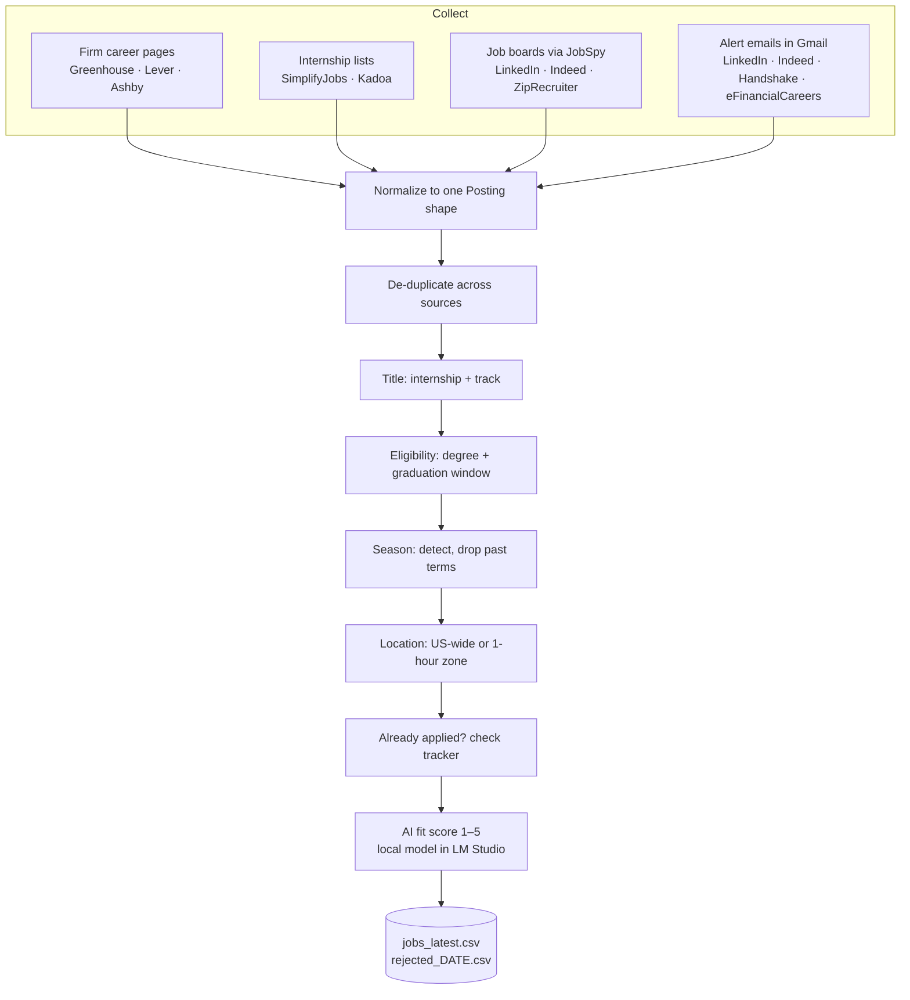

# finance-internship-engine

[](https://github.com/sling54/finance-internship-engine/actions/workflows/ci.yml)

An automated search pipeline for finance internships. Every day it collects postings from firm
career pages, curated internship lists, job boards and job-alert emails, merges duplicates, and
filters them down to the roles worth applying to, with a logged reason for every role it drops.

I built it to run my own search for trading, quant and derivatives internships. Doing that search
by hand meant checking a dozen sites a day and rereading the same postings.

**Sample run (Nov 2, 2026), lists only:** 4,321 postings collected from SimplifyJobs and Kadoa →
156 kept after filtering and de-duplication (22 of the kept roles appeared in both lists and were merged).

## How it works



| # | Source | How it's read | Module |
|---|--------|---------------|--------|
| 1 | Firm boards on Greenhouse, Lever, Ashby (DV, Flow Traders, IMC, Jane Street, Five Rings, Point72 and others) | Public job APIs, one call per firm | `scanners/ats.py` |
| 2 | Firms on Workday and other portals (AQR, SIG, Citadel, Group One) | Covered through Kadoa's dataset | `scanners/lists.py` |
| 3 | [SimplifyJobs](https://github.com/SimplifyJobs/Summer2027-Internships) internship list | JSON file on GitHub | `scanners/lists.py` |
| 4 | [Kadoa quant-jobs](https://github.com/kadoa-org/quant-jobs) | JSON file on GitHub (about 4,300 quant roles, internships kept) | `scanners/lists.py` |
| 5 | LinkedIn, Indeed, ZipRecruiter | [JobSpy](https://github.com/speedyapply/JobSpy), public listings, logged out | `scanners/boards.py` |
| 6 | Job-alert emails | Gmail API reads one label; job links parsed from the HTML | `scanners/alerts.py` |

The engine never logs into a job site. Firm board tokens in `config/firms.yml` were taken from
live posting URLs, not guessed.

## The filters

Each filter either passes a posting or raises `Rejected("reason")`, so every dropped role is
written to `rejected_DATE.csv` with its reason.

| Filter | Keeps | Drops |
|--------|-------|-------|
| **Title** (`titles.yml`) | Internships matching a track: Trading, Quant / derivatives, Buy-side, Data, SWE, Wealth | Investment banking, M&A, audit, PhD- or master's-only titles, full-time roles |
| **Eligibility** | Bachelor's-eligible roles asking for graduates in the profile's window (or naming no date) | `PhD only`, `Class of 2026`, `graduating Spring 2027` |
| **Season** | Upcoming terms, read from term lists, titles ("2027 Summer Internship", "January Start") and descriptions ("15–20 hours per week") | Terms already started, terms starting after graduation |
| **Location** | Summer roles anywhere in the US; fall, winter, spring, part-time and all Data/SWE roles within a 1-hour drive of campus, or remote | Non-US roles, far-away semester roles, "Remote in UK" |
| **Already applied** | Everything else | Roles already in the application tracker spreadsheet, matched despite wording differences |

Roles the engine can't judge are kept but flagged for review: `check season`, `check location`,
`check drive time`, `check division`. New roles since the last run are flagged `new`.

## AI fit score

After filtering, a local model running in [LM Studio](https://lmstudio.ai) reads each kept role's
description next to my profile and resume and scores it 1–5 with a one-line reason
(`fit_score`, `fit_reason` columns). It also settles the flagged roles, such as a plain
"Summer Analyst" whose division only the description reveals. Nothing leaves the laptop.

- **What it looks for** is plain English in `config/scoring.yml` (`what_i_want` and `rubric`).
- **Cached:** scores are saved in `data/scores.json`, so a daily run only scores new roles.
  Editing `scoring.yml`, the profile or the resume re-scores everything automatically.
- **Never blocks a scan:** if LM Studio isn't running, the scan finishes without scores. After
  3 failed replies in a row it stops asking and keeps what it has.
- The AI never drops a role. It only scores it, so a wrong call costs a lower rank, not a lost job.

**De-duplication.** The same role often appears in several sources with different wording
("Quantitative Trading Intern - Summer 2027 (DV Equities)" vs "Quantitative Trading Intern -
DV Equities", "DV Trading" vs "DV Trading LLC"). Companies are matched with legal suffixes
removed, and titles are matched on their word sets with years and filler removed. The copy from
the most trusted source (firm board > Kadoa > Simplify > boards and emails) is kept, and the
other copies add their locations and sources.

**Drive time.** City lists in `config/sources.yml` decide most cases offline. For Florida places
not on the lists, the engine can check against a real 60-minute driving zone from
[OpenRouteService](https://openrouteservice.org) (one API call to draw it, cached afterwards).

## Run it

Requires Python 3.10+.

```bash
git clone https://github.com/sling54/finance-internship-engine.git
cd finance-internship-engine
python3 -m venv .venv
source .venv/bin/activate
pip install -e ".[dev]"
cp config/profile.example.yml config/profile.yml   # then edit it with your details
jobengine scan
```

Results land in `data/jobs_latest.csv`. Useful options:

```bash
jobengine scan --only simplify kadoa    # just these sources
jobengine scan --no-ai                  # skip the AI fit score
jobengine -v scan                       # log every source call
pip install -e ".[jobspy]"              # enable job boards (set jobspy.enabled: true)
pip install -e ".[gmail]"               # enable alert emails (set alert_emails.enabled: true)
jobengine zone                          # draw the drive-time zone (needs ORS_API_KEY in .env)
```

## Privacy

Personal files never reach this repo. `.gitignore` excludes `config/profile.yml`, the `data/`
folder (results, tracker, caches), spreadsheets, PDFs, `.env` and Google OAuth tokens. The
committed `profile.example.yml` holds fake data, and the tests always run against it.

## Tests

```bash
pytest -q
```

84 tests cover each source parser, each filter (including the five location cases from the
design), de-duplication, the AI scorer (with a fake LM Studio) and an end-to-end run against a
fixture tracker spreadsheet. GitHub
Actions runs lint and tests on Python 3.10 and 3.12 on every push.

## Project layout

```
config/          titles.yml, firms.yml, sources.yml, scoring.yml, profile.example.yml
src/jobengine/
  scanners/      ats.py, lists.py, boards.py, alerts.py
  filters/       titles.py, eligibility.py, season.py, location.py, dedup.py, applied.py
  pipeline.py    collect -> dedupe -> filter -> AI score -> CSV
  scorer.py      LM Studio fit score, cached in data/scores.json
  zone.py        OpenRouteService drive-time zone
  cli.py         `jobengine scan`, `jobengine zone`
tests/           pytest suite and fixtures
```

## Roadmap

- [x] Collect from six sources, de-duplicate, filter by title, eligibility, season, location
- [x] Fit score (1–5) for each role from a local LLM, with a one-line reason
- [ ] Application packets: tailored resume and prefilled answers (submission stays manual)
- [ ] Tracker sync: Gmail status emails update the application spreadsheet
- [ ] Outreach: recruiter contact drafts, sent only after approval

## License

MIT
